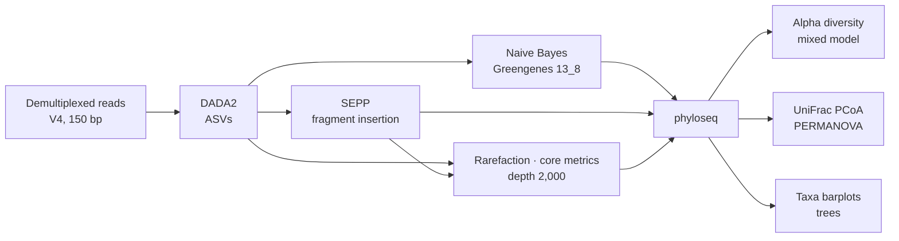
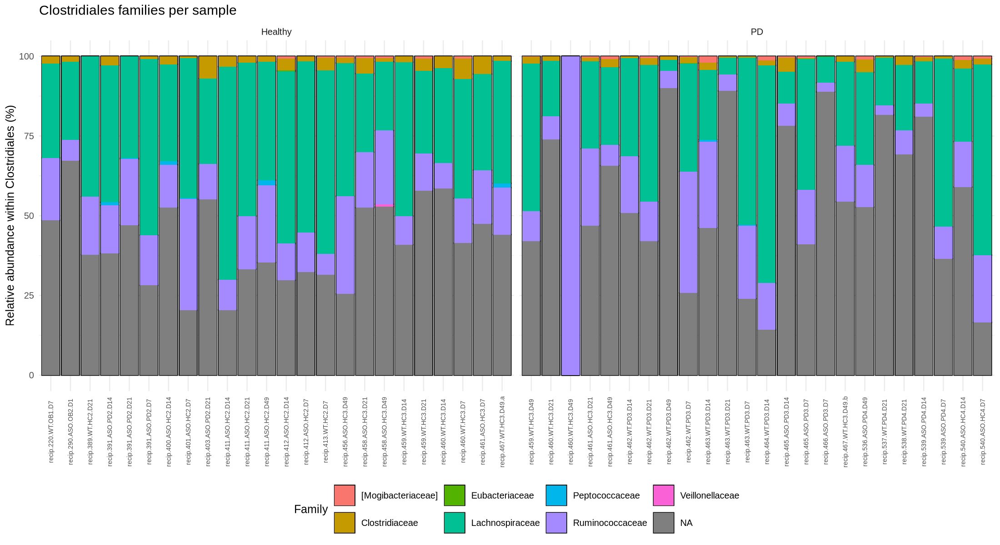
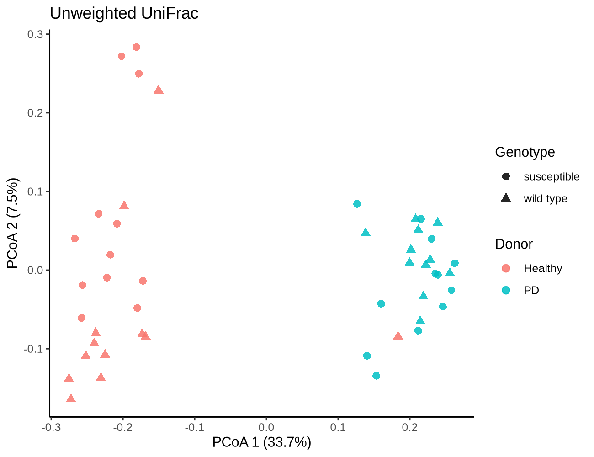
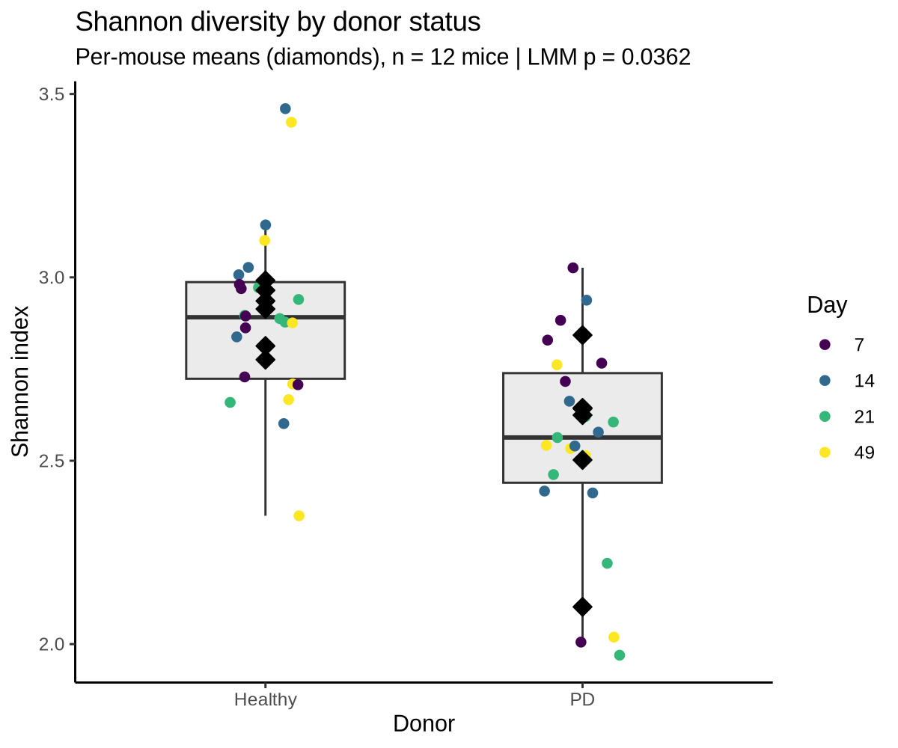
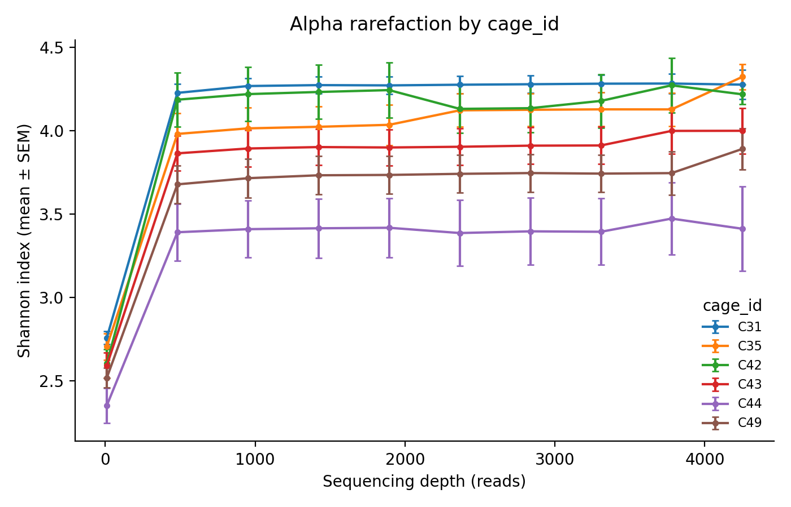
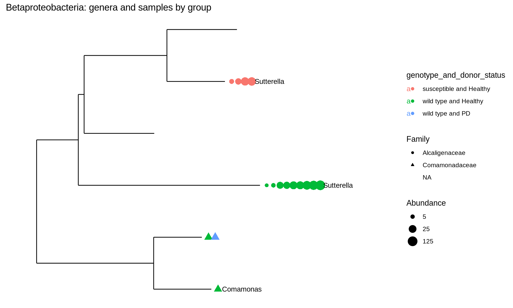

# 16S rRNA microbiome analysis: gut microbiota in a mouse model of Parkinson's disease

Amplicon analysis (16S rRNA V4) of 48 fecal samples from germ-free mice colonised with microbiota from healthy or Parkinson's disease (PD) donors ([Sampson *et al.*, 2016, *Cell*](https://doi.org/10.1016/j.cell.2016.11.018); public data of the [QIIME 2 Parkinson's Mouse tutorial](https://docs.qiime2.org/2024.10/tutorials/pd-mice/)). The pipeline runs QIIME 2 for denoising, taxonomy, phylogeny and diversity, then R (phyloseq, vegan, lme4) for statistics and figures.

**Key result:** donor status explains **43% of the variation in community composition** (PERMANOVA on unweighted UniFrac, one sample per mouse, p = 0.0002). Mice colonised from PD donors also have **lower Shannon diversity** (2.55 vs 2.90). That difference is significant only when the repeated-measures design is respected: **p = 0.036 with a mixed model**, against p = 6 × 10⁻⁵ when the 47 samples from 12 mice are wrongly treated as independent.

## Workflow



| Step | Script | Tools |
|---|---|---|
| Download | `00_download_data.sh` | metadata, reads, Greengenes classifier, SEPP reference |
| Import | `01_import_demux.sh` | `qiime tools import` (Phred33 manifest), demux summary |
| Denoising | `02_dada2.sh` | DADA2 (`--p-trunc-len 150`), per-sample stats |
| Taxonomy | `03_taxonomy.sh` | `classify-sklearn`, Greengenes 13_8 99% V4; taxa barplot |
| Phylogeny | `04_phylogeny.sh` | SEPP fragment insertion into the Greengenes tree |
| Diversity | `05_diversity.sh` | alpha rarefaction (to 4,250 reads), core-metrics-phylogenetic (depth 2,000) |
| Export | `06_export.sh` | feature table, taxonomy, tree and UniFrac distances to plain files |
| Statistics and figures | `07_phyloseq_analysis.R` | phyloseq, vegan (PERMANOVA), lme4/lmerTest (mixed models) |
| Rarefaction plot | `08_plot_rarefaction.py` | Shannon rarefaction curves by cage |

## How to run

```bash
git clone https://github.com/Dvid99/pd-mice-16s-microbiome.git
cd pd-mice-16s-microbiome
# environments: see envs/README.md (QIIME 2 amplicon 2024.10 + envs/r-analysis.yml)

conda activate qiime2-amplicon-2024.10
bash scripts/run_all.sh qiime      # steps 0-6 and the rarefaction plot

conda activate pd-mice-r
bash scripts/run_all.sh r          # step 7
```

The whole pipeline has been run end to end on Google Colab with [`notebooks/run_on_colab.ipynb`](notebooks/run_on_colab.ipynb) (about 1 h on 2 CPUs).

## Study design

12 mice (6 cages × 2), genotype wild type or ASO (α-synuclein-overexpressing, PD-susceptible), sampled 4 times (days 7, 14, 21 and 49 after colonisation) → 48 samples.

**Two features of the design shape the statistics:**
- **Repeated measures:** the 48 samples come from only 12 mice, so samples from the same mouse are not independent.
- **Cage confounded with donor:** every cage holds mice of a single donor group (C31, C35 and C42 healthy; C43, C44 and C49 PD). Cage effects (shared microbiota through coprophagy) and donor effects cannot be fully separated, so cage is modelled as a random effect.

## Results

### Denoising and taxonomy

- **287 ASVs** across 48 samples; median 5,102 input and 4,294 non-chimeric reads per sample.
- **`recip.460.WT.HC3.D49` keeps only 347 of 16,327 reads (2.1%).** Only 61% of its reads pass the quality filter, and most of the rest are lost in denoising, which suggests a failed library. It is excluded at the rarefaction depth of 2,000 reads.
- Most abundant families (mean relative abundance): **Bacteroidaceae 54%, Lachnospiraceae 9%, Porphyromonadaceae 4.5%, Ruminococcaceae 4%**. A further 12% are Clostridiales that Greengenes cannot assign to a family.
- **Clostridiales:** 143 of 287 ASVs, dominated by Lachnospiraceae and Ruminococcaceae.

<p align="center"></p>

### Beta diversity: the donor microbiota dominates

<p align="center"></p>

Samples separate completely by donor on the first PCoA axis (33.7% of the variation), whatever the mouse genotype. PERMANOVA on one sample per mouse (last time point, n = 12) avoids pseudoreplication:

| Term | R² | p |
|---|---|---|
| Donor status | **0.43** | **0.0002** |
| Genotype | 0.08 | 0.13 |

### Alpha diversity: why the statistical test matters

Mean Shannon index: **healthy donor 2.90, PD donor 2.55**.

| Test | Units | p-value |
|---|---|---|
| Wilcoxon, every sample as independent (naive) | 47 samples | 6.0 × 10⁻⁵ |
| Wilcoxon on per-mouse means | 12 mice | 0.013 |
| **Linear mixed model** `shannon ~ donor + day + (1 \| cage/mouse)` | 47 samples, 12 mice, 6 cages | **0.036** |

<p align="center"></p>

The naive test treats four samples from the same mouse as four mice. It overstates the evidence by more than two orders of magnitude. The effect is real, but modest, once mouse and cage are accounted for. The three lowest-diversity samples all come from **mouse 539** (ASO, PD donor, cage C44), with Shannon values of 1.97–2.02.

> Note: the sample IDs encode a label (e.g. `recip.463.WT.PD3.D21`) that does not always match the metadata. For example, that sample belongs to ASO mouse 539. Genotype and mouse were always taken from the metadata.

### Rarefaction by cage

<p align="center"></p>

Shannon curves plateau below ~1,000 reads, so a depth of 2,000 captures the diversity of every sample but one. The healthy-donor cages (C31, C35, C42: Shannon 4.2–4.3 at 4,250 reads) sit above the PD-donor cages (C43, C49 and C44: 4.0, 3.9 and 3.4). That is the donor effect again, seen through the cage confounding.

### Betaproteobacteria

6 ASVs from Alcaligenaceae (*Sutterella*) and Comamonadaceae (*Comamonas*). *Sutterella* is found mainly in mice colonised from healthy donors.

<p align="center"></p>

## Notes

- Shannon values in R use the natural logarithm, as `phyloseq::estimate_richness` and `microbiome::alpha` do. QIIME 2 reports Shannon in log₂, which is why the rarefaction curves (QIIME 2) show higher values than the R analysis.
- Taxonomy uses the Greengenes 13_8 classifier from the original tutorial. For new projects, SILVA 138 or Greengenes2 are better maintained.

## References

- Sampson TR *et al.* (2016). Gut microbiota regulate motor deficits and neuroinflammation in a model of Parkinson's disease. *Cell* 167:1469–1480.
- Bolyen E *et al.* (2019). Reproducible, interactive, scalable and extensible microbiome data science using QIIME 2. *Nat Biotechnol* 37:852–857.
- Callahan BJ *et al.* (2016). DADA2: high-resolution sample inference from Illumina amplicon data. *Nat Methods* 13:581–583.
- Janssen S *et al.* (2018). Phylogenetic placement of exact amplicon sequences improves associations with clinical information. *mSystems* 3:e00021-18.
- McMurdie PJ, Holmes S (2013). phyloseq: an R package for reproducible interactive analysis and graphics of microbiome census data. *PLoS ONE* 8:e61217.
- Bates D *et al.* (2015). Fitting linear mixed-effects models using lme4. *J Stat Softw* 67:1–48.

## Author

**David Gómez Collado** — MSc Bioinformatics (VIU), BSc Biotechnology (Universidad de Extremadura).
